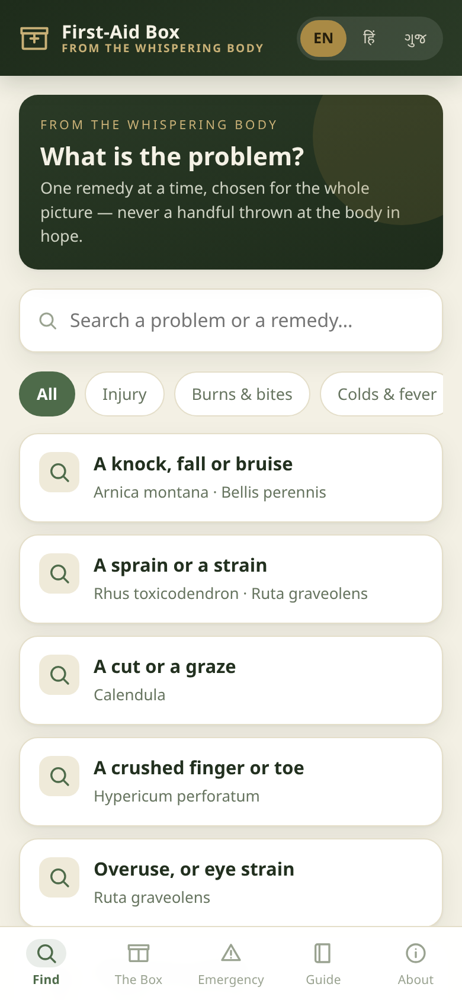
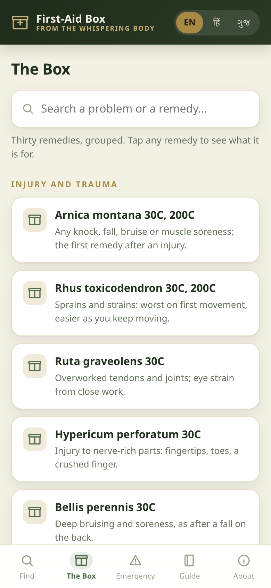
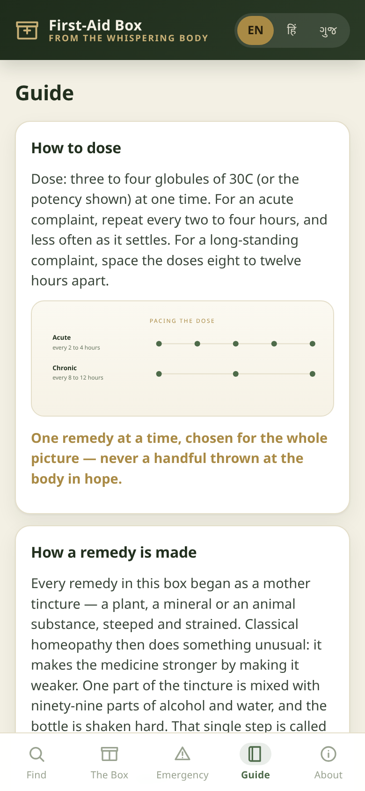

<!-- ===== Landing page banner ===== -->
<h1 align="center">The Whispering Body — First‑Aid Box</h1>

<b>A free, offline home first-aid companion app to the book <i>The Whispering Body</i> by Dr.&nbsp;Sohil&nbsp;Momin.</b> 
30 commonly used homeopathic first-aid remedies, a plain-language symptom finder, dosing and handling guidance, and emergency signs — in English, हिन्दी and ગુજરાતી.

  
  
  
  
  
  

<h3 align="center">▶&nbsp; <a href="https://drsamonline.github.io/whispering-body-first-aid/play/">Open the app</a> &nbsp;·&nbsp; <a href="https://drsamonline.github.io/whispering-body-first-aid/">Visit the landing page</a></h3>

⬇ <a href="https://github.com/drsamonline/whispering-body-first-aid/releases/latest/download/whispering-body-first-aid-portable.exe">Download for Windows (.exe)</a> &nbsp;·&nbsp; <a href="https://github.com/drsamonline/whispering-body-first-aid/releases/latest/download/whispering-body-first-aid.apk">Download for Android (.apk)</a>

Works offline · installs to your home screen · free to use 
<b>General information only — not a substitute for professional medical care. In an emergency, call 112 or 108.</b>

---

<!-- Banner -->

<b>A free companion app to the book <i>The Whispering Body</i> by Dr.&nbsp;Sohil&nbsp;Momin.</b>

<!-- Badges -->

  
  
  
  

  
  
  
  
  
  

<!-- Call to action -->
<h3 align="center">▶&nbsp; <a href="https://drsamonline.github.io/whispering-body-first-aid/play/">Open the app</a></h3>

Works offline · installs to your home screen · free to use

<!-- Screenshots -->

  
  &nbsp;
  
  &nbsp;
  

---

## What it is

A small, offline **home first-aid companion** built from Chapter Seven of the
book. It holds **30 commonly used homeopathic first-aid remedies** and helps you
match one remedy to the whole picture of a symptom — the same "listen, then
match" method the book teaches.

It is a **single web app**: no account, no tracking, no internet needed once it
is open. The guide and the about page carry hand-drawn **SVG diagrams** — how a
remedy is made, how to pace a dose, and the listening loop.

## Features

| | |
|---|---|
| 🔍 **Find** | Pick the problem in plain language — "a burn or a scald", "food poisoning" — and see the matching remedy. |
| 🧰 **The Box** | All 30 remedies, grouped, with search. Tap one for what it is for and its keynote. |
| ⚠️ **Emergency** | The signs that mean *get medical help now*, on a red panel with a one-tap call button. |
| 📖 **Guide** | How to dose · how a remedy is made (mother tincture → 1C → 30C → globules) · how to carry and handle the box · how to use it. |
| 🌐 **Languages** | English · हिन्दी · ગુજરાતી — the whole interface and content. |
| 📴 **Offline** | Installs to the home screen and runs without a connection. |
| ℹ️ **About & licence** | What the app is, the licence terms, and the required attribution — inside the app. |

## Install it on your phone

1. Open **[the app](https://drsamonline.github.io/whispering-body-first-aid/play/)** in your phone's browser.
2. **Add to Home screen** — *Share ▸ Add to Home Screen* on iOS, or the **⋮** menu ▸ *Add to Home screen* on Android.
3. It now opens like an app, and works offline.

## The remedies it covers

<b>All 30, by group</b> (tap to expand)

- **Injury and trauma** — Arnica montana · Rhus toxicodendron · Ruta graveolens · Hypericum perforatum · Bellis perennis
- **Cuts, grazes, burns and bites** — Calendula · Cantharis · Apis mellifica · Ledum palustre · Urtica urens · Hepar sulphuris · Silicea
- **Colds, fever and children** — Aconite · Belladonna · Ferrum phosphoricum · Allium cepa · Chamomilla · Ipecac
- **Stomach and digestion** — Nux vomica · Arsenicum album · Colocynthis · Robinia · Arg. nit · Veratrum album
- **Head and nerves** — Glonine · Sanguinaria · Bryonia alba · Ignatia
- **Warts and slow healing** — Thuja · Nitric acid

## Safety

> This app gives **general information** about homeopathic first-aid practice. It is **not** a substitute for diagnosis or treatment by a qualified clinician, and it is never a reason to delay conventional medical care. In an emergency, seek conventional medical help first — in India, call **112** or **108**.

## Licence

  
  
  

**Free to use. The content is copyrighted. A licence is required to reuse it.**

- **Free to use** — use the app yourself, on your own devices, at no cost.
- **Content is copyrighted** — everything inside the app (remedy descriptions,
  the finder text, the guide, the translations, the design) is the copyrighted
  work of **Dr. Sohil Momin**, drawn from the book *The Whispering Body*.
  Copyright applies inside the app exactly as it applies in the book.
- **A licence is required to use it in other projects** — you may not reuse the
  app, its code or its content in another project, product, website, app,
  publication, course or dataset without written permission.
- **Attribution is required in derivative works** — where a licence is granted,
  the derivative work must carry a visible credit:

  > Based on *"The Whispering Body — First-Aid Box"* by Dr. Sohil Momin
  > https://drsamonline.github.io/whispering-body-first-aid/

Read the full terms in **[LICENSE](LICENSE)**.

## About the book

*The Whispering Body: An Alternate Explanation and Storyteller's Guide to
Homeopathy* — a story-first guide for the student and the household reader
alike, in English, Hindi and Gujarati.

---

  © 2026 Dr. Sohil Momin · All rights reserved · Licensing: sohilmomin2000@gmail.com 
  This repository contains <b>only the companion app</b>, not the book.

